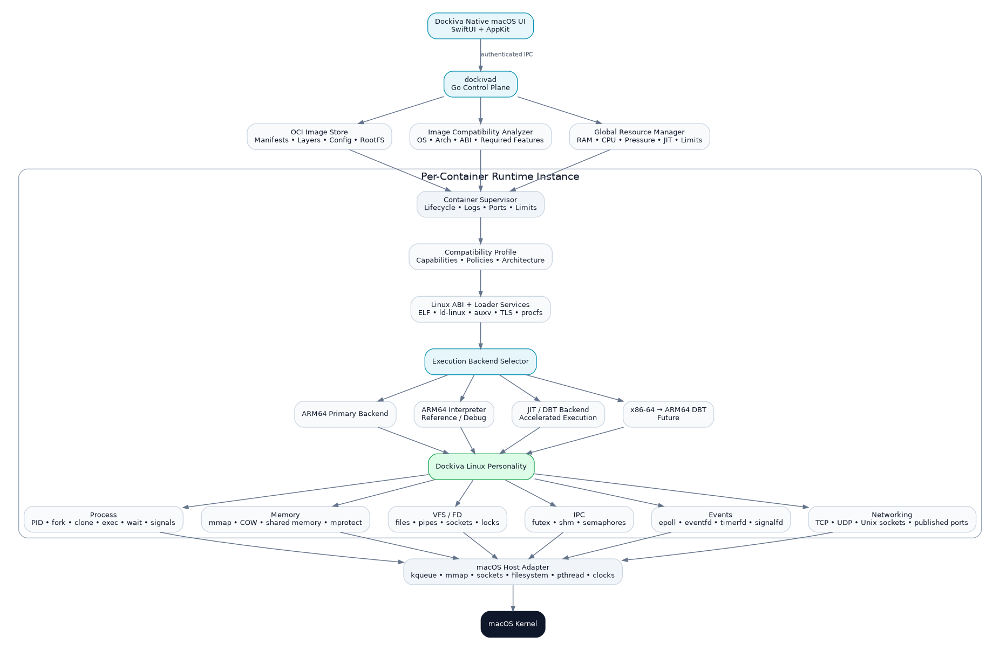

# Dockiva final runtime architecture — baseline v1.0

Adopted 2026-09-22 at the user’s request. This is the production target, not a claim of implemented support. The [unchanged source document](specifications/dockiva_final_architecture_v1.docx) is authoritative for the frozen top-level decisions. This Markdown transcription preserves its text, tables and diagram. Implementation contracts and the milestone ledger live in the vmfree-runtime repository. [Dockiva preview status](../VMFREE-PREVIEW.md) distinguishes current behavior from this target.

DOCKIVA

Final Runtime Architecture Specification

VM-free Linux userspace execution on macOS

Architecture baseline v1.0

| STATUS  This document is the frozen baseline for implementation. Future changes should be driven by conformance evidence, not by routine redesign. |
| --- |

Primary host target: macOS on Apple Silicon

Primary guest target: Linux ARM64 OCI workloads

## 1. Executive Summary

Dockiva is a macOS-first container/runtime platform designed to run standard Linux userspace workloads without booting a traditional Linux virtual machine. The defining architecture is not “syscall-to-syscall translation.” Dockiva models Linux semantics in userspace through a stateful Linux Personality layer, then implements those semantics with macOS primitives.

| CORE PRINCIPLE  Linux behavior is modeled first; macOS APIs are implementation mechanisms, not semantic substitutes. |
| --- |

- Native macOS UI using SwiftUI with AppKit where necessary.

- Go control plane (dockivad) for OCI images, lifecycle, networking, storage, resource management, supervision, and IPC.

- Native C runtime for ELF loading, CPU execution backends, Linux ABI services, and Linux Personality semantics.

- No Python dependency in the production execution path; Python remains useful for testing, fuzzing, tracing, and benchmarking.

- Linux ARM64 is the first execution target; linux/amd64 is a later DBT target.

- 8 GB host machines are a first-class product constraint, requiring global and per-container memory accounting.

- Valkey persistence is the first serious compatibility gate; PostgreSQL crash recovery is the second.

- No application-specific compatibility hacks for Redis, Valkey, PostgreSQL, or other named workloads.

## 2. Product Scope and Non-Goals

### 2.1 Initial product promise

Recommended positioning: “Run standard Linux OCI workloads directly on macOS without a traditional Linux VM.”

The initial promise should not be “runs every Docker image.” OCI format support and runtime compatibility are separate concerns. Dockiva may be able to pull and inspect an image while still classifying the workload as experimental or unsupported.

### 2.2 Explicit non-goals for the first architecture

- Full Linux kernel compatibility.

- Linux kernel modules or arbitrary kernel drivers.

- /dev/kvm and nested virtualization workloads.

- Windows containers.

- Complete eBPF kernel behavior.

- CUDA/Linux kernel-driver compatibility.

- Guaranteed execution of every OCI/Docker image.

- Perfect x86-64 compatibility in the first release.

## 3. Frozen Architecture

The following diagram is the final baseline. Implementation work should evolve inside these boundaries unless conformance testing demonstrates that a boundary is fundamentally incorrect.

Figure 1. Dockiva final architecture baseline

| Native Dockiva UI         │         ▼ dockivad — Go control plane         │         ▼ Container supervisor / OCI management         │         ▼ Dockiva native runtime         │         ▼ Dockiva Linux Personality         │         ▼ macOS Host Adapter         │         ▼ macOS Kernel |
| --- |

## 4. Layer Responsibilities

| Layer | Technology | Responsibility |
| --- | --- | --- |
| Native UI | SwiftUI + AppKit | Containers, images, volumes, networks, logs, resource usage, compatibility status, settings, notifications. No runtime semantics. |
| dockivad | Go | Control plane: OCI, image management, lifecycle, supervisors, networking, storage, resource policy, compatibility orchestration, IPC. |
| Runtime core | C | Linux ABI/loader services, CPU execution backends, guest address spaces, Linux Personality entry points. |
| Linux Personality | C | Stateful Linux process, memory, VFS/FD, IPC, events, and networking semantics. |
| Host Adapter | C / platform bindings | Translate internal semantic operations into macOS primitives such as kqueue, mmap, sockets, filesystem operations, pthreads, and clocks. |
| Conformance suite | Test tooling | Proves semantic behavior using small tests first and real workloads later; prevents app-specific fixes. |

## 5. dockivad: Go Control Plane

dockivad is the long-lived control plane. It must not contain guest Linux semantics; those belong to the runtime. The daemon owns orchestration and policy.

- OCI registry/image interaction and local image store.

- Container create/start/stop/restart/remove lifecycle.

- Prepared root filesystem and writable-layer management.

- Port publishing, host networking configuration, and container network metadata.

- Resource policy and host-pressure response.

- Per-container supervisor creation and monitoring.

- Compatibility analysis and status reporting.

- Authenticated local IPC used by the native UI.

- Structured logs, status, diagnostics, and runtime health.

| PRODUCTION PATH  UI → dockivad → native runtime. Python is excluded from this path to keep startup, memory use, packaging, and failure modes under tighter control. |
| --- |

## 6. OCI Image Pipeline and Compatibility Analysis

### 6.1 Image selection

| dockiva run nginx:latest         │         ▼ Read OCI index / manifest list         │         ├── linux/arm64  → preferred on Apple Silicon         ├── linux/amd64  → future x86-64 DBT path         └── other        → unsupported unless backend exists         │         ▼ Prepare RootFS + image config         │         ▼ Compatibility analysis         │         ▼ Launch or reject with reason |
| --- |

### 6.2 Compatibility statuses

| Status | Meaning |
| --- | --- |
| SUPPORTED | Actively covered by Dockiva conformance/workload tests. |
| COMPATIBLE | Required features appear implemented but the workload is not yet part of the supported test matrix. |
| EXPERIMENTAL | Uses semantics that are incomplete, new, or not yet validated under stress/crash testing. |
| UNSUPPORTED | Requires a device, kernel feature, architecture, or semantic behavior Dockiva does not provide. |

The analyzer should inspect at least: image OS/architecture, ELF type, dynamic linker, required libraries, declared capabilities, device expectations, and known feature requirements. Dynamic runtime behavior must still be validated during execution; static inspection alone cannot guarantee compatibility.

## 7. Native Runtime and Execution Backends

Execution backends are deliberately pluggable. Their responsibility is CPU execution, not Linux semantics.

| Backend | Role | Priority |
| --- | --- | --- |
| ARM64 primary backend | Execute Linux ARM64 guest code on Apple Silicon with the lowest practical overhead. | Primary |
| ARM64 interpreter | Deterministic, instrumentable reference implementation for debugging and differential testing. | Keep permanently |
| JIT / DBT backend | Accelerated execution with bounded code cache and instrumentation hooks. | Production optimization |
| x86-64 → ARM64 DBT | Run linux/amd64 images when no ARM64 variant exists. | Later phase |

| BOUNDARY  The CPU backend must call into the same Linux Personality interfaces. Switching Interpreter → JIT must not change guest-visible Linux behavior. |
| --- |

## 8. Dockiva Linux Personality

This is the architectural center of Dockiva: a userspace Linux kernel personality that maintains guest Linux state and semantics independently from the host API chosen to implement them.

### 8.1 Process model

- PID and process table

- fork / clone / exec / exit / wait

- threads and process groups

- signal masks, queues, delivery, and inheritance

- file-descriptor inheritance rules

### 8.2 Virtual memory

- guest address spaces

- mmap / munmap / mprotect / brk

- copy-on-write page relationships

- MAP_SHARED and shared-memory mappings

- page accounting and reclaim hooks

### 8.3 VFS and file descriptors

- open/read/write/stat/rename/unlink semantics

- file descriptor tables and lifecycle

- pipes and Unix sockets

- permissions and path handling

- file locks and descriptor inheritance

### 8.4 Synchronization and IPC

- futex wait/wake semantics

- shared memory

- semaphores

- inter-process synchronization state

### 8.5 Event system

- epoll objects and watched-FD registries

- level/edge-trigger behavior

- EPOLLONESHOT-style state

- eventfd / timerfd / signalfd semantics

- pending event queues

### 8.6 Networking

- TCP and UDP sockets

- Unix-domain sockets

- bind/listen/accept/connect

- socket options and readiness

- published host ports

## 9. Mandatory Semantic Rule

Do not implement Linux as a direct map to the “closest” macOS syscall. Implement the Linux abstraction first, update guest state, and use one or more macOS primitives underneath.

| Incorrect Linux API    ↓ closest macOS API  Correct Linux API    ↓ Dockiva Linux semantic object/state    ↓ Guest-visible state transition    ↓ macOS primitive(s) |
| --- |

Example: epoll should be represented by a Dockiva epoll object with registrations, readiness state, edge-trigger state, one-shot state, and pending events. kqueue is a host mechanism used by that object; kqueue is not itself the Linux epoll model.

## 10. 8 GB Host Memory Architecture

Support for 8 GB machines is a first-class product requirement. The architecture must therefore avoid duplicating guest memory and must enforce both global and per-container budgets.

| Global Resource Manager │ ├── Host RAM + current available memory ├── macOS memory-pressure state ├── Dockiva global ceiling ├── Per-container memory limits ├── Guest page accounting ├── Copy-on-write accounting ├── JIT / translated-code cache budget ├── Cache and log reclamation └── Admission control for new workloads |
| --- |

### 10.1 Single guest-memory model

Interpreter, JIT/DBT, syscall handling, and debugging must reference one guest address-space model. Do not create full independent copies of guest RAM for each execution backend.

| Guest virtual address space         │         ├── Interpreter view         ├── JIT / DBT view         ├── Syscall / Personality view         └── Debugger / trace view  All views reference the same page model. |
| --- |

### 10.2 Copy-on-write is both compatibility and memory infrastructure

Valkey/Redis persistence and PostgreSQL process behavior make correct COW important. fork() should initially share page backing and duplicate only modified pages where Linux semantics require it.

### 10.3 JIT cache policy

- Hard maximum per host profile and/or per container.

- LRU or comparable cold-block eviction.

- Aggressive reduction during host memory pressure.

- No unbounded translated-code growth.

Illustrative budgets such as “3 GB Dockiva budget” or “64 MB JIT cache” are not constants. dockivad should derive budgets from actual available memory, pressure state, active workloads, and user limits.

## 11. Per-Container Runtime State

- Root filesystem view and writable layer.

- Environment and image configuration.

- Guest PID namespace / process table.

- Virtual address spaces and COW relationships.

- FD tables, pipes, sockets, and locks.

- Signal state.

- Futex and IPC state.

- epoll/event/timer objects.

- Shared-memory objects.

- Networking and published-port state.

- Resource limits and usage accounting.

- Logs and selected execution backend.

Safe immutable resources should be shared across containers where practical, including OCI read-only layers, executable pages, runtime code, and translated code where correctness permits. Writable guest pages and container writes remain private or copy-on-write.

## 12. UI-to-Daemon IPC and Trust Boundary

The native UI is a client of dockivad, not the owner of runtime state. A local Unix-domain socket is a reasonable initial IPC mechanism.

- Socket permissions restricted to the current user (for example 0600).

- Peer UID validation.

- Session or token authentication.

- Per-request authorization/capability checks.

- Structured request/response schema with versioning.

- Runtime operations remain available even if the UI restarts.

XPC can be considered later for macOS-specific helper/security requirements, but it is not required to establish the initial architecture.

## 13. Container Launch Flow

1.  UI sends a create/run request to dockivad.

2.  dockivad resolves the OCI image and selects the best platform manifest.

3.  The image store prepares layers and the container root filesystem.

4.  The compatibility analyzer classifies architecture and known feature requirements.

5.  The resource manager checks host pressure and container admission limits.

6.  A per-container supervisor and guest Linux state are created.

7.  Linux ABI/loader services load the guest ELF and runtime linker state.

8.  The backend selector chooses ARM64, interpreter, JIT/DBT, or a future x86-64 path.

9.  Guest syscalls and exceptions enter the Dockiva Linux Personality.

10.  The Host Adapter uses macOS primitives to satisfy the modeled Linux operation.

11.  dockivad exposes logs, metrics, status, published ports, and lifecycle control to the UI.

## 14. Docker/OCI Image Compatibility Strategy

The architecture supports broad OCI image compatibility, but “image format support” does not equal “workload support.” Runtime success depends on architecture, Linux ABI coverage, kernel semantics, device expectations, filesystem behavior, and networking behavior.

| Workload / image class | Initial position |
| --- | --- |
| linux/arm64 standard userspace | Primary target |
| Multi-arch image with linux/arm64 | Prefer ARM64 variant automatically |
| linux/amd64 | Future x86-64 → ARM64 DBT |
| linux/arm/v7 | Unsupported until an ARM32 backend exists |
| Windows containers | Unsupported by Linux Personality |
| Kernel modules / /dev/kvm | Unsupported |
| eBPF-heavy workloads | Experimental/unsupported depending on feature |
| GPU/CUDA images | Separate future device/driver compatibility problem |
| nginx / Go / common CLI workloads | Early compatibility targets |
| Valkey / Redis | Major semantic validation workload |
| PostgreSQL | Advanced semantic + crash-consistency validation workload |

## 15. Conformance and Workload Validation

Dockiva should advance through deterministic semantic gates instead of reacting to application crashes by adding special cases.

### 15.1 Valkey gate

| Gate | Validation |
| --- | --- |
| V0 | Server starts |
| V1 | PING |
| V2 | SET / GET |
| V3 | Concurrent clients |
| V4 | Sustained workload |
| V5 | SAVE |
| V6 | BGSAVE: fork + COW + wait/signals |
| V7 | AOF |
| V8 | AOF rewrite |
| V9 | Graceful shutdown |
| V10 | Forced crash |
| V11 | Restart + persistence validation |

### 15.2 PostgreSQL gate

| Gate | Validation |
| --- | --- |
| P0 | postgres --version |
| P1 | initdb |
| P2 | Server startup |
| P3 | Single connection |
| P4 | CRUD |
| P5 | Concurrent backends |
| P6 | Shared-memory workloads |
| P7 | WAL behavior |
| P8 | Checkpoint |
| P9 | Forced crash during writes |
| P10 | WAL recovery |
| P11 | Checksum/data validation |
| P12 | Long-running stress test |

| VALIDATION RULE  If Valkey exposes an epoll defect, fix the generic epoll model. If PostgreSQL exposes MAP_SHARED or durability defects, fix those generic semantics. Never add “if (valkey)” or “if (postgres)” compatibility branches. |
| --- |

## 16. Recommended Implementation Sequence

1.  Process model: fork, clone, exec, exit, wait, signal state and inheritance.

2.  Virtual memory: mmap, mprotect, shared mapping, COW, address-space accounting.

3.  VFS / FD behavior: descriptor lifecycle, files, pipes, sockets, locks, path semantics.

4.  Synchronization and IPC: futex, shared memory, semaphores.

5.  Event model: epoll, eventfd, timerfd, signalfd.

6.  Networking semantics and port publishing.

7.  Resource manager integration and pressure-driven reclaim.

8.  Valkey V0 → V11.

9.  PostgreSQL P0 → P12.

10.  Only after semantic stability: performance optimization, x86-64 DBT, and broader workloads.

## 17. Recommended Repository Structure

| dockiva/ │ ├── app/ │   └── macos/ │       ├── SwiftUI/ │       └── AppKit/ │ ├── daemon/ │   ├── cmd/dockivad/ │   ├── oci/ │   ├── images/ │   ├── containers/ │   ├── networking/ │   ├── storage/ │   ├── resources/ │   ├── compatibility/ │   └── ipc/ │ ├── runtime/ │   ├── loader/ │   ├── abi/ │   ├── personality/ │   │   ├── process/ │   │   ├── memory/ │   │   ├── vfs/ │   │   ├── ipc/ │   │   ├── events/ │   │   └── network/ │   ├── backends/ │   │   ├── arm64/ │   │   ├── interpreter/ │   │   ├── jit/ │   │   └── x86_64/ │   └── host/ │       └── macos/ │ ├── tests/ │   ├── syscall/ │   ├── linux-abi/ │   ├── busybox/ │   ├── nginx/ │   ├── valkey/ │   ├── postgres/ │   └── stress/ │ └── tools/     ├── trace/     ├── benchmark/     └── fuzz/ |
| --- |

## 18. Production Deliverables

| Dockiva.app     │     ▼ dockivad     │     ▼ libdockiva_runtime.dylib     │     ▼ macOS |
| --- |

Exact packaging can change, but these three conceptual production components should remain separate: native user experience, control plane, and runtime engine.

## 19. Frozen Design Decisions

| Area | Decision |
| --- | --- |
| UI | Native macOS: SwiftUI + AppKit |
| Control plane | Go (dockivad) |
| Runtime core | C |
| Python in production path | No |
| Container/image standard | OCI |
| Primary guest | linux/arm64 |
| Primary host | macOS ARM64 |
| CPU architecture | Pluggable execution backends |
| Reference execution | ARM64 interpreter retained permanently |
| Acceleration | JIT/DBT with bounded cache |
| Future architecture | x86-64 → ARM64 DBT |
| Linux compatibility | Stateful Linux Personality |
| Host integration | Dedicated macOS Host Adapter |
| Memory strategy | Global + per-container budgets, COW, shared immutable pages |
| Workload fixes | Generic semantic fixes only; no named-app hacks |
| First major gate | Valkey persistence |
| Second major gate | PostgreSQL crash recovery |

## 20. Future Extension: Self-Healing Infrastructure

The self-healing concept should be layered above dockivad after runtime correctness is established. It is not part of the first compatibility milestone.

| Dockiva AI / Recovery Control Plane Observe → Diagnose → Reproduce → Recover → Verify                     │                     ▼                  dockivad                     │                     ▼              Dockiva Runtime |
| --- |

- Runtime metrics and events become inputs to diagnosis.

- Low-risk recovery actions may include restart, rollback, resource adjustment, or traffic movement.

- Code-generation/patch workflows should come only after strong sandboxing, canarying, verification, and human approval policies are established.

## 21. Architecture Acceptance Criteria

- Basic ELF/BusyBox/Go workloads run through the same Linux Personality interfaces used by complex workloads.

- Execution backend changes do not alter guest-visible semantics.

- Guest memory is not duplicated per backend.

- Memory pressure can reduce JIT/cache footprint without corrupting guest state.

- An 8 GB host can run meaningful lightweight workloads without requiring a full Linux VM allocation.

- Valkey passes V11 using an unchanged stock Linux ARM64 binary and no named-app hacks.

- PostgreSQL passes P12, including forced-crash recovery and data validation.

- Unsupported images fail early with an explicit compatibility reason rather than mysterious runtime crashes.

- The native UI can restart independently while dockivad continues to own runtime state.

## 22. Final Direction

Freeze the top-level architecture here. The next engineering effort should improve the Linux Personality and conformance suite, not repeatedly redesign the control plane or UI/runtime boundaries. Valkey persistence and PostgreSQL crash recovery are the evidence gates that determine whether the VM-free approach is truly viable for production server workloads.

| NEXT ENGINEERING FOCUS  Process model → virtual memory/COW → VFS/FD → futex/IPC → epoll/events → networking → Valkey V11 → PostgreSQL P12. |
| --- |
